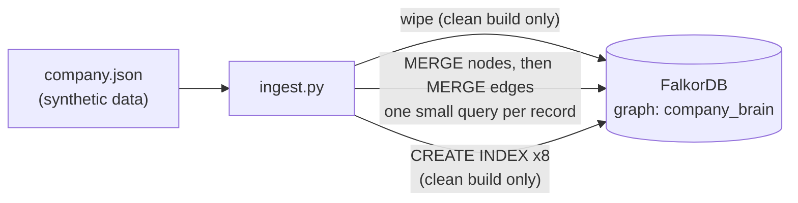
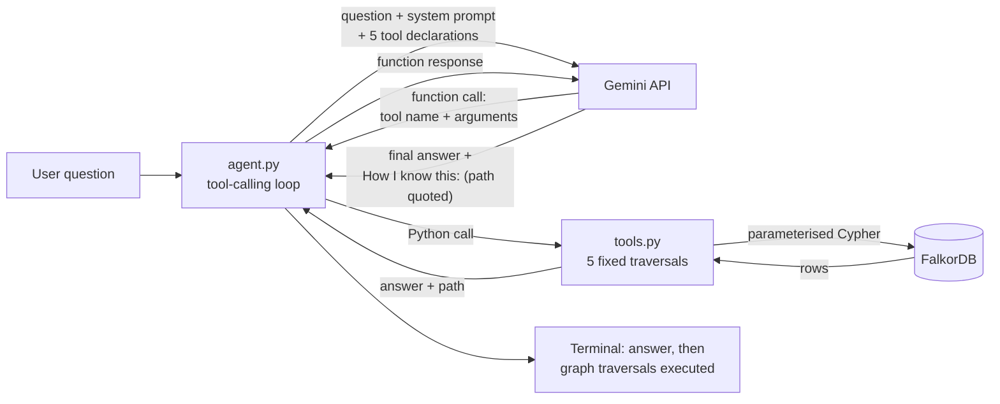
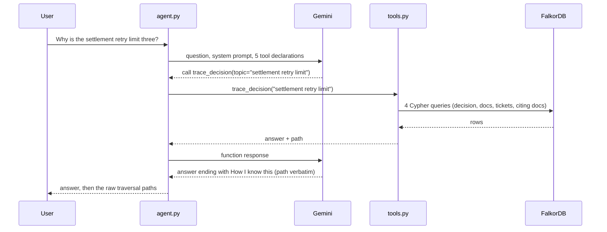
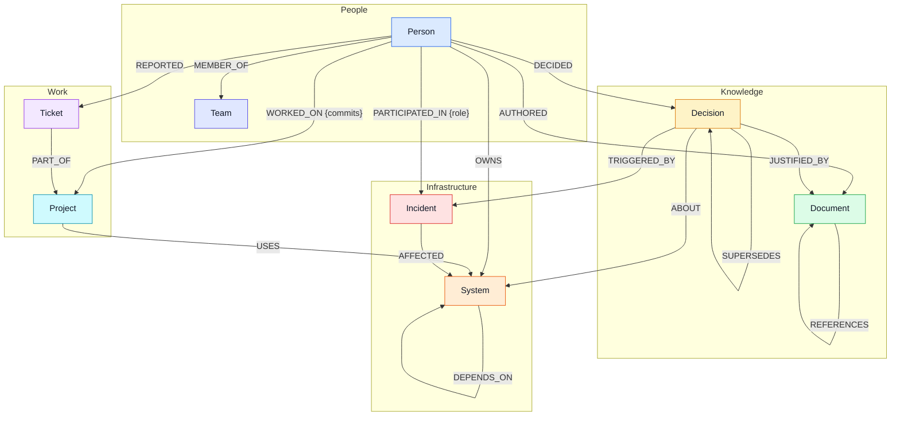
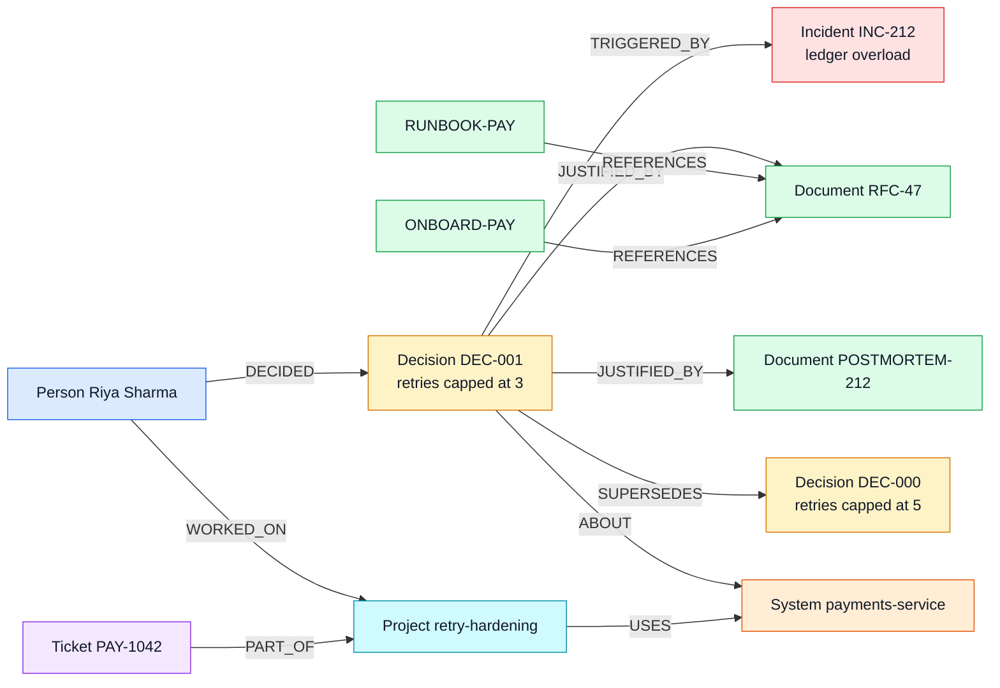
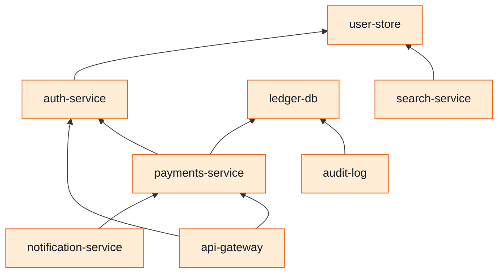
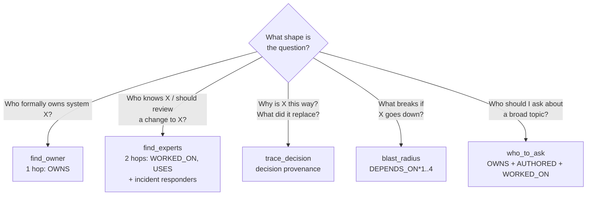
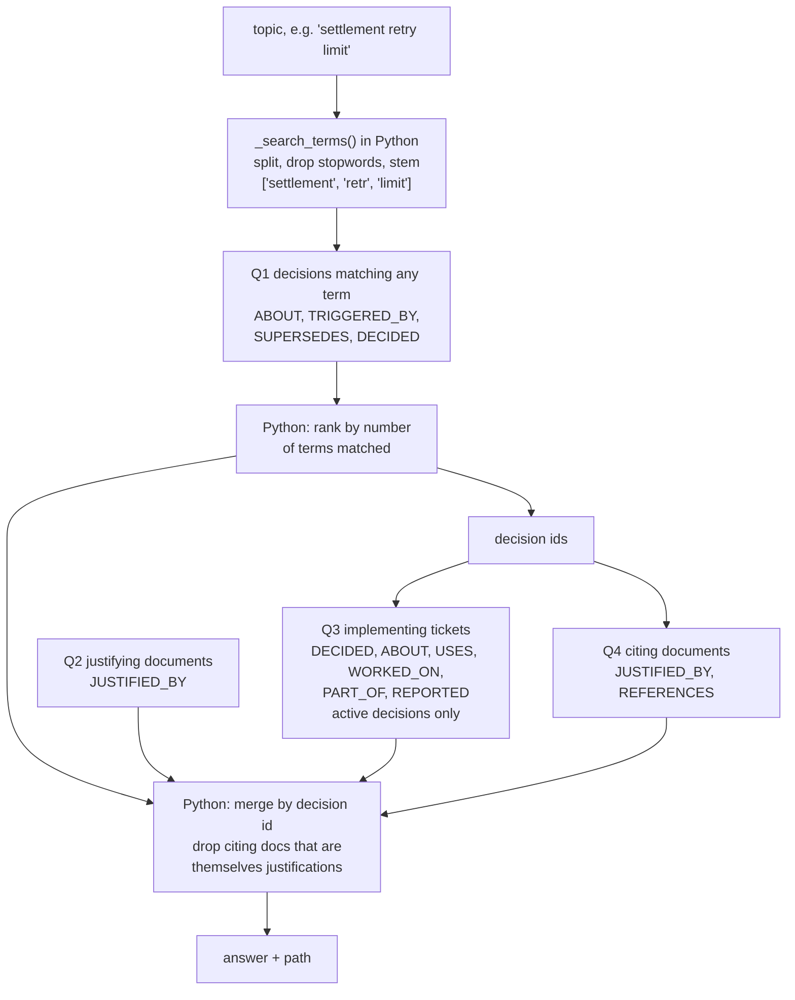
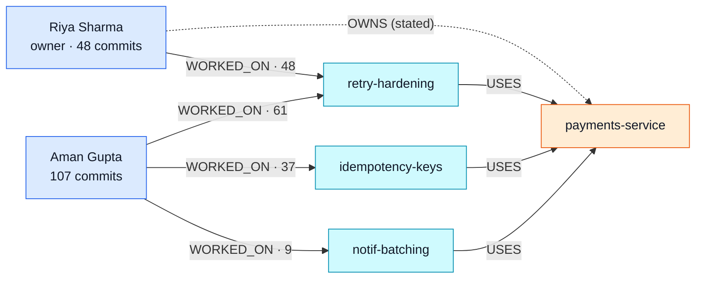
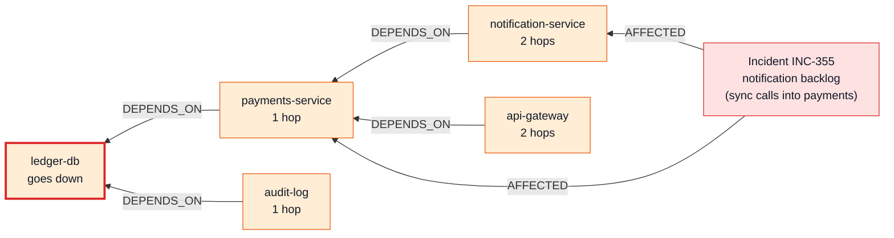

# Architecture

How Company Brain fits together: the components, the graph data model, the
five agent tools, and why the graph is load-bearing.

**Other docs:** [README.md](README.md) (user-facing entry point and setup) ·
[TECH_PRD.md](TECH_PRD.md) (what and why) · [DECISIONS.md](DECISIONS.md)
(design decision log) · [STATE.md](STATE.md) (current status, known issues,
what to read first) · [CLAUDE.md](CLAUDE.md) (working rules for AI assistants)

---

## Contents

1. [Summary](#1-summary)
2. [Components](#2-components)
3. [Runtime flow](#3-runtime-flow) — [building the graph](#31-building-the-graph-offline-once) · [answering a question](#32-answering-a-question)
4. [Graph data model](#4-graph-data-model) — [schema](#41-schema-diagram) · [nodes](#42-node-labels) · [relationships](#43-relationship-types) · [indexes](#44-indexes) · [key structures](#45-the-datasets-key-structures)
5. [The five tools](#5-the-five-tools) — [summary](#51-summary) · [which tool answers what](#52-which-tool-answers-which-question) · [edge coverage](#53-edge-coverage) · [details](#54-tool-details) · [topic matching](#55-topic-matching-trace_decision-who_to_ask)
6. [Why the graph is load-bearing](#6-why-the-graph-is-load-bearing)
7. [FalkorDB facts this design relies on](#7-falkordb-facts-this-design-relies-on)
8. [Configuration](#8-configuration)

**Colour key** used in every data diagram (the schema in §4.1 doubles as the
legend): Person blue · Team indigo · System orange · Decision amber ·
Document green · Incident red · Project cyan · Ticket purple.

## 1. Summary

Company Brain answers questions about how a (fictional, synthetic) engineering
organisation works — who owns what, who actually knows what, why a decision
was made, what breaks if a system fails.

- **The knowledge lives in a FalkorDB graph**, built from `company.json`.
- **Gemini reads the question and picks one or more of five pre-written graph
  traversals** — Python functions in `tools.py`, each running fixed Cypher.
- **Gemini never sees the graph and never writes Cypher.** It only chooses a
  tool and its arguments.
- **Every tool returns an answer plus the path** of edges it actually matched.
- **The agent must quote that path verbatim** under a "How I know this:"
  heading, and `agent.py` also prints it independently.
- **There is no vector store, no embedding and no document retriever.** If
  FalkorDB is removed, the product cannot answer anything.

## 2. Components

| File | Role |
|---|---|
| `company.json` | Synthetic dataset for the fictional company "Acme". The only data source. |
| `graph.py` | Opens the FalkorDB connection. Loads `.env` (via `python-dotenv`) so every entry point sees the same configuration. Exposes `get_graph()` and `GRAPH_NAME`. |
| `ingest.py` | Builds the graph from `company.json` using `MERGE` statements. `python ingest.py` wipes and rebuilds; `python ingest.py --update` merges on top of the existing graph without wiping. |
| `tools.py` | The five agent tools. Each runs one to four parameterised Cypher queries, merges rows in Python, and returns `{"answer": ..., "path": ...}`. Registry: `TOOLS`. |
| `agent.py` | The Gemini tool-calling loop: system prompt, the five function declarations, request pacing and retry, and the CLI (`--demo`, single question, interactive). |
| `.env` / `.env.example` | Configuration. `.env` holds real values and is gitignored; `.env.example` lists every variable with placeholders. **Never put real credentials anywhere else.** |
| `CLAUDE.md` | Standing working rules for AI coding assistants on this repo. |

There is no frontend, server or test suite in the repository (see
[DECISIONS.md](DECISIONS.md) D-007 and [STATE.md](STATE.md)).

## 3. Runtime flow

### 3.1 Building the graph (offline, once)



### 3.2 Answering a question



The same flow as a sequence, for the headline demo question:



Key properties of the loop (`agent.py`, function `ask`):

- **Bounded:** at most 6 model round-trips per question, so a confused model
  cannot loop forever.
- **Deterministic-ish:** `temperature=0`.
- **Parallel tool calls are allowed:** Gemini may call several tools in one
  turn (it calls `find_experts` and `find_owner` together for "who should
  review…").
- **Tool errors are returned to the model** as `{"error": ...}` rather than
  crashing, so it can say the graph has no answer.
- **Evidence printed independently of the model:** after every answer,
  `agent.py` prints the `path` of every tool that ran ("graph traversals
  executed"). This is the ground truth even if the model's own "How I know
  this:" were incomplete.
- **Rate limiting:** every Gemini call goes through `generate()`, which spaces
  requests `60 / GEMINI_REQUESTS_PER_MINUTE + 1` seconds apart (13 s by default)
  and retries 429 / 5xx responses with backoff. Details in
  [STATE.md](STATE.md#gemini).
- **Failure isolation:** `answer_question()` catches any exception for one
  question, prints `[!] Could not answer: ...`, and moves on.

## 4. Graph data model

### 4.1 Schema diagram

Arrows show relationship direction; edge properties are in braces. Node
labels are grouped by role: **People** (who), **Work** (what is being done),
**Knowledge** (what was written and decided) and **Infrastructure** (what
runs, and what goes wrong with it). Self-loops (`SUPERSEDES`, `REFERENCES`,
`DEPENDS_ON`) connect a label to itself.



### 4.2 Node labels

Every label has one key property (indexed, used by `MERGE`) and is created by
`ingest.py`. Counts are for the current `company.json` (62 nodes in total).

| Label | Key | Other properties | Count | Meaning |
|---|---|---|---|---|
| `Person` | `email` | `name`, `role`, `slack` | 15 | An engineer, manager or SRE. |
| `Team` | `name` | `charter` | 5 | Payments, Platform, Growth, Data, SRE. |
| `System` | `name` | `type` (service / database / datastore), `tier` (critical / standard) | 8 | A deployable service or datastore. |
| `Project` | `name` | `repo`, `year` | 7 | A body of work in a repo, e.g. `retry-hardening`. |
| `Document` | `id` | `title`, `type` (RFC / postmortem / runbook / ADR / guide), `url`, `created_at`, `body` | 9 | Written knowledge. `body` is short text used only for keyword matching in `who_to_ask`. |
| `Ticket` | `id` | `title`, `status` (open / in progress / done), `created_at` | 7 | A tracked work item. |
| `Incident` | `id` | `title`, `occurred_at`, `severity` (SEV1-3), `summary` | 5 | A production incident. |
| `Decision` | `id` | `statement`, `made_at`, `status` (active / superseded) | 6 | A recorded technical decision. The spine of the model. |

Dates are ISO strings (`YYYY-MM-DD`), so string comparison sorts correctly.

### 4.3 Relationship types

16 types, 139 relationships in total.

| Relationship | Direction | Properties | Count | Meaning |
|---|---|---|---|---|
| `MEMBER_OF` | Person → Team | | 15 | Team membership (one team per person). |
| `OWNS` | Person → System | | 8 | **Stated**, formal ownership. |
| `WORKED_ON` | Person → Project | `commits` (int) | 18 | Contribution. Powers **inferred** expertise. |
| `AUTHORED` | Person → Document | | 9 | Who wrote a document. |
| `REPORTED` | Person → Ticket | | 7 | Who filed a ticket. |
| `PARTICIPATED_IN` | Person → Incident | `role` (incident commander / responder) | 12 | Incident response. |
| `DECIDED` | Person → Decision | | 6 | Who made a decision. |
| `USES` | Project → System | | 13 | Which systems a project touches. |
| `PART_OF` | Ticket → Project | | 7 | Which project a ticket belongs to. |
| `DEPENDS_ON` | System → System | | 8 | `A DEPENDS_ON B` means A calls / needs B. Powers blast radius. |
| `AFFECTED` | Incident → System | | 10 | Systems hit by an incident. |
| `REFERENCES` | Document → Document | | 7 | `A REFERENCES B` means A cites B. |
| `ABOUT` | Decision → System | | 6 | The system a decision governs. |
| `TRIGGERED_BY` | Decision → Incident | | 5 | The incident that caused the decision (provenance). |
| `JUSTIFIED_BY` | Decision → Document | | 7 | Documents giving the reasoning (provenance). |
| `SUPERSEDES` | Decision → Decision | | 1 | `new SUPERSEDES old` (decision history). |

There is deliberately **no** Decision → Project or Ticket → Decision edge. See
[DECISIONS.md](DECISIONS.md) D-010 for how tickets are reached instead.

### 4.4 Indexes

Created at the end of a clean build: `Person.email`, `System.name`,
`Document.id`, `Decision.id`, `Incident.id`, `Project.name`, `Ticket.id`,
`Team.name`. These are the keys every traversal starts from.

### 4.5 The dataset's key structures

The retry decision chain (the motivating example):



The system dependency graph (all 8 `DEPENDS_ON` edges; arrow = "depends on"):



## 5. The five tools

All tools live in `tools.py` and are registered in `TOOLS`. Every one returns:

```python
{"answer": {...} or "No ... found ...",   # what Gemini uses to reply
 "path":   "(A:x)-[:REL]->(B:y); ... | ..."}  # edges actually matched
```

**Path format:** `(Label:value)-[:REL]->(Label:value)` segments, joined by
`; ` within one result item and ` | ` between result items. A path is built
**only from rows the query returned**, so it can only name edges that exist and
were matched. When nothing matches, the path says `— no match`.

### 5.1 Summary

| Tool | Answers | Hops | Edges walked | Queries |
|---|---|---|---|---|
| `find_owner(system)` | Who formally owns a system? | 1 | `OWNS`, `MEMBER_OF` | 1 |
| `find_experts(system, limit=5)` | Who actually knows a system? (inferred) | 2 | `WORKED_ON`, `USES`, `MEMBER_OF`, `PARTICIPATED_IN`, `AFFECTED` | 2 |
| `trace_decision(topic)` | Why is something this way, and what came before? | 1–3 | `ABOUT`, `TRIGGERED_BY`, `SUPERSEDES`, `DECIDED`, `JUSTIFIED_BY`, `REFERENCES`, `USES`, `WORKED_ON`, `PART_OF`, `REPORTED` | 4 |
| `blast_radius(system, max_depth=4)` | What breaks if a system goes down? | 1–4 (variable) | `DEPENDS_ON` (transitive), `OWNS` | 2 |
| `who_to_ask(topic)` | Who should I talk to about a topic? | 1–2 | `OWNS`, `AUTHORED`, `WORKED_ON`, `USES`, `MEMBER_OF` | 3 |

The exact Cypher for all 12 queries is in [README.md](README.md#the-cypher-the-product-depends-on)
and in `tools.py`; the two are kept identical.

### 5.2 Which tool answers which question

Gemini makes this choice from the tool descriptions in `agent.py`; the map
below mirrors those descriptions. A question can match more than one shape —
"who should review a change to X?" makes Gemini call `find_experts` **and**
`find_owner` in the same turn.



### 5.3 Edge coverage

Every relationship type is traversed by at least one tool (a hackathon
requirement — unused data looks decorative):

| Relationship | Traversed by |
|---|---|
| `MEMBER_OF` | find_owner, find_experts, who_to_ask |
| `OWNS` | find_owner, blast_radius, who_to_ask |
| `WORKED_ON` | find_experts, trace_decision, who_to_ask |
| `USES` | find_experts, trace_decision, who_to_ask |
| `AUTHORED` | who_to_ask |
| `PARTICIPATED_IN`, `AFFECTED` | find_experts |
| `DEPENDS_ON` | blast_radius |
| `ABOUT`, `TRIGGERED_BY`, `JUSTIFIED_BY`, `SUPERSEDES`, `DECIDED`, `REFERENCES`, `PART_OF`, `REPORTED` | trace_decision |

### 5.4 Tool details

#### `find_owner(system)`
- **Matches** `(Person)-[:OWNS]->(System {name: $system})`, optionally the
  owner's `Team`. Exact system name.
- **Returns** `{system, owners: [{name, email, role, team, tier}]}`.
- **Purpose:** the baseline — the one answer an org chart already has.

#### `find_experts(system, limit=5)`
- **Query 1** walks `(Person)-[w:WORKED_ON]->(Project)-[:USES]->(System)`,
  groups by person, `sum(w.commits)`, orders by commits, `LIMIT` inlined as
  `int(limit)`.
- **Query 2** walks `(Person)-[r:PARTICIPATED_IN]->(Incident)-[:AFFECTED]->(System)`.
- **Returns** `{system, by_contribution: [{name, email, team,
  commits_on_related_projects, via_projects}], incident_responders: [{name,
  incidents, role}]}`. Commits are cast to `int` in Python (FalkorDB's `sum()`
  returns a float).
- **Purpose:** expertise is written nowhere; it is derived from the graph.

#### `trace_decision(topic)`
Four queries, merged by decision id in Python:
1. **Decisions** matching any search term in `statement` or the `ABOUT`
   system's name, with optional `TRIGGERED_BY` incident, `SUPERSEDES` target
   and `DECIDED` person.
2. **Justifying documents** via `JUSTIFIED_BY`.
3. **Implementing tickets:** projects that `USES` the decision's system **and**
   that the deciding person `WORKED_ON`, then tickets `PART_OF` those
   projects, plus `REPORTED` by. Active decisions only.
4. **Citing documents:** documents that `REFERENCES` a justifying document,
   excluding documents that are themselves justifications.



Q2 does not depend on Q1's results (it fetches every `JUSTIFIED_BY` edge and is
filtered during the merge); Q3 and Q4 only run for the decision ids Q1 found.

Decisions are ranked by how many search terms they match (ties keep
newest-first order). **Returns** `{topic, decisions: [{decision_id, statement,
status, made_at, about_system, decided_by, triggered_by, justified_by,
cited_by, tickets, supersedes}]}`.

#### `blast_radius(system, max_depth=4)`
- **Query 1:** `MATCH path = (affected:System)-[:DEPENDS_ON*1..N]->(s:System)`
  with `N = int(max_depth)` inlined (Cypher does not allow parameters in
  variable-length bounds), plus owners. `min(length(path))` reports each
  system at its **shortest** distance.
- **Query 2:** what the system itself depends on (one hop outward).
- **Returns** `{system, impacted: [{system, tier, hops_away, owners}],
  this_system_depends_on}`, with a `note` when nothing depends on it.

#### `who_to_ask(topic)`
- Three queries, one per edge type: `OWNS` (system name matches), `AUTHORED`
  (document title or body matches), `WORKED_ON`→`USES` (project or system
  name matches).
- Merged per person in Python and ranked **owner (1) > author (2) >
  contributor (3)**, then by number of reasons. It ranks by *kind* of
  connection, not volume — volume is `find_experts`' job.
- **Returns** `{topic, people: [{name, email, team, reasons, rank}]}`. The path
  uses edge notation; a project that uses several systems is folded into one
  edge, e.g. `(System:audit-log/ledger-db)`.

### 5.5 Topic matching (`trace_decision`, `who_to_ask`)

`_search_terms(topic)` in `tools.py` lower-cases the topic, splits it into words
(keeping hyphenated names like `payments-service` whole), drops words under 3
letters and a short stopword list, and strips one plural-like suffix
(`ies`, `es`, `s`, `y`) so `retry` and `retries` both become `retr`.
Cypher then keeps a record if **any** term is a substring of the relevant
field: `WHERE any(term IN $terms WHERE toLower(x) CONTAINS term)`.

This is deliberately simple keyword matching, not semantic search. Its limits
are listed in [STATE.md](STATE.md#known-issues).

## 6. Why the graph is load-bearing

The hackathon rule: *"if the product still works once FalkorDB is taken out,
the graph is decoration."* Here, every answer comes from a Cypher traversal and
there is nothing to fall back on. More importantly, three of the five tools
answer questions **no document contains**:

**Inferred expertise — the owner is not the expert.** The data says Riya
Sharma `OWNS` payments-service. `find_experts("payments-service")` walks two
hops and finds:

| Person | Team | Commits on projects that use payments-service |
|---|---|---|
| Aman Gupta | Payments | **107** (retry-hardening 61 + idempotency-keys 37 + notif-batching 9) |
| Riya Sharma (owner) | Payments | 48 |
| Priya Nair | Growth | 44 |
| Nikhil Rao | Payments | 41 |
| Jonas Weber | Growth | 26 |

The fan-out is the point. The owner reaches payments-service through one
project; Aman reaches it through three (the dashed edge is the only *stated*
fact — everything else is derived):



Aman has more than twice the owner's commits, and two Growth-team engineers
(Priya, Jonas) surface through notif-batching. No record states any of this.

**Transitive impact — the two-hop path.** `notification-service` never touches
`ledger-db`. But `notification-service DEPENDS_ON payments-service DEPENDS_ON
ledger-db`, so `blast_radius("ledger-db")` reports notification-service (and
api-gateway) at **2 hops**. Incident INC-355 — notifications falling four hours
behind because of synchronous calls into payments-service — is this exact
dependency showing up in production. This is everything
`blast_radius("ledger-db")` returns, with INC-355 alongside:



**Decision provenance.** "Why is the retry limit three?" spans
Decision → Incident → Documents → citing Documents → Ticket → superseded
Decision. The pieces were written separately; only the edges join them.

## 7. FalkorDB facts this design relies on

Verified against the live FalkorDB Cloud instance (graph module version
reported as `42200`, i.e. FalkorDB 4.22) on 2026-10-18:

| Construct | Works? | Used? |
|---|---|---|
| `any(x IN $list WHERE ...)` with a list parameter | ✅ | Yes — topic matching |
| `d.id IN $ids` | ✅ | Yes |
| Named variable-length path + `length()` + `min()` | ✅ | Yes — blast_radius |
| `UNION` | ✅ | No (separate queries chosen for clarity, D-008) |
| `EXISTS { MATCH ... }` | ❌ parse error | Never use |
| `exists((a)-[:R]->(b))` | ❌ "Unable to resolve filtered alias" | Never use |
| Bare pattern predicate `WHERE (a)-[:R]->(b)` / `WHERE NOT ...` | ✅ | Not currently |
| `$param` in `LIMIT` / variable-length bounds | not used | Values inlined via `int()` instead |
| `sum()` | returns a float | Cast to `int` in Python |

## 8. Configuration

All configuration is environment variables, loaded from `.env` by
`graph.py` and `agent.py`. Names only — values live in `.env` (gitignored);
see `.env.example` for placeholders.

| Variable | Used by | Default | Notes |
|---|---|---|---|
| `GEMINI_API_KEY` | agent.py | — | Required for the agent; not needed for tools/ingest. |
| `GEMINI_MODEL` | agent.py | see `MODEL` in agent.py | See [STATE.md](STATE.md#gemini). |
| `GEMINI_REQUESTS_PER_MINUTE` | agent.py | 5 | Free-tier per-minute limit; raise on a paid key. |
| `FALKORDB_HOST`, `FALKORDB_PORT` | graph.py | localhost, 6379 | |
| `FALKORDB_USERNAME`, `FALKORDB_PASSWORD` | graph.py | none | Needed for FalkorDB Cloud only. |
| `FALKORDB_SSL` | graph.py | false | `true` hung on our Cloud instance; leave false unless told otherwise. |
| `FALKORDB_GRAPH` | graph.py | company_brain | Graph name. |
