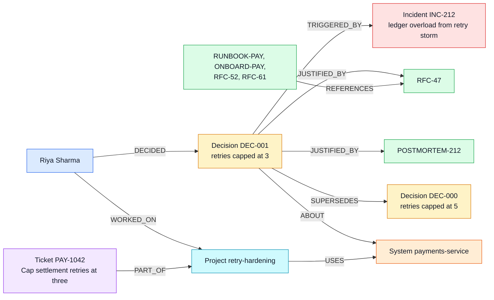

# Company Brain

An agent that understands how an engineering organisation works, by reasoning
over a FalkorDB knowledge graph rather than retrieving documents.

**Graph Hacks 2026 — Track 03: Company Brain**

---

## Contents

- [The problem](#the-problem)
- [Why the graph is load-bearing](#why-the-graph-is-load-bearing)
  - [A concrete example: the owner is not the expert](#a-concrete-example-the-owner-is-not-the-expert)
- [How this maps to Track 03](#how-this-maps-to-track-03)
- [Setup](#setup)
- [Demo questions](#demo-questions)
- [The graph data model](#the-graph-data-model)
  - [Nodes](#nodes)
  - [Relationships](#relationships)
- [The Cypher the product depends on](#the-cypher-the-product-depends-on)
  - [`find_owner` — one hop](#find_owner--one-hop)
  - [`find_experts` — inferred expertise, two hops](#find_experts--inferred-expertise-two-hops)
  - [`trace_decision` — decision provenance](#trace_decision--decision-provenance)
  - [`blast_radius` — transitive dependencies, up to 4 hops (configurable)](#blast_radius--transitive-dependencies-up-to-4-hops-configurable)
  - [`who_to_ask` — three traversals, merged and ranked by person](#who_to_ask--three-traversals-merged-and-ranked-by-person)
- [How explainability works](#how-explainability-works)
- [Data](#data)
- [Future work](#future-work)
- [Project layout](#project-layout)
- [Further documentation](#further-documentation)
- [AI assistance disclosure](#ai-assistance-disclosure)
- [Licence](#licence)

## The problem

Ask an engineering org a question like *"why is the settlement retry limit
three?"* and the honest answer is a chain, not a document:



Colours mark node types: amber decisions, red incidents, green documents,
orange systems, blue people, cyan projects, purple tickets.

No single document contains that chain. RFC-47 mentions the incident but not
the decision it replaced. The postmortem predates the decision. The ticket
that implemented it lives in a different system again. A vector search returns
passages that *sound* related, which is not the same as the reasoning.

This project stores those relationships directly and lets the agent walk them,
so every answer arrives with the path that produced it.

## Why the graph is load-bearing

Remove FalkorDB and this product does not degrade — it stops working. There is
no vector index, no document retriever and no embedding store to fall back on.
All five agent tools are Cypher traversals, and three of them answer questions
that have no source document at all:

| Question | Why no document answers it |
|---|---|
| "Who should review a change to payments-service?" | Expertise is derived from `Person→Project→System` contribution counts plus incident participation. It is written down nowhere. |
| "What breaks if auth-service goes down?" | Requires transitive `DEPENDS_ON` traversal, up to 4 hops (configurable). |
| "Why is the retry limit three, and what was it before?" | Spans Decision → Incident → Document → citing Documents → Ticket → superseded Decision. |

### A concrete example: the owner is not the expert

The org chart says Riya Sharma owns `payments-service`. Ask the graph who
actually knows it — `find_experts("payments-service")`, which walks
`(Person)-[:WORKED_ON]->(Project)-[:USES]->(System)` and sums commits — and
you get a different answer:

| Person | Team | Commits on projects that use payments-service | Via |
|---|---|---|---|
| Aman Gupta | Payments | **107** | retry-hardening, idempotency-keys, notif-batching |
| Riya Sharma *(formal owner)* | Payments | 48 | retry-hardening |
| Priya Nair | **Growth** | 44 | notif-batching |
| Nikhil Rao | Payments | 41 | retry-hardening, idempotency-keys |
| Jonas Weber | **Growth** | 26 | notif-batching |

Aman has more than twice the owner's commits, spread across three projects —
and he also responded to both payments incidents (INC-212, INC-287). Two
people from a *different team* surface because their notification project
calls payments-service. None of this is stated in any document, ticket or
profile; it exists only as a two-hop pattern in the graph.

## How this maps to Track 03

| Track 03 focus | How Company Brain covers it |
|---|---|
| Knowledge from docs, tickets, and chats in one graph | Documents, tickets, incidents, decisions, people and systems in one graph. Chat ingestion is **not** implemented — see [Future work](#future-work). |
| Who owns what, and who knows what | `find_owner` (stated ownership), `find_experts` (inferred expertise), `who_to_ask` (ranked across three edge types). |
| Tracing decisions back to their source | `trace_decision`: incident, justifying documents, documents that cite them, implementing tickets, superseded decision. |
| Keeping knowledge current as things change | `ingest.py` is MERGE-based throughout. `python ingest.py --update` loads `company.json` on top of the live graph without wiping it: new records are added, changed properties are updated, and nothing is duplicated. Verified: running it on an existing graph leaves all 8 node counts and all 16 relationship counts unchanged, and a changed ticket status is picked up. Try it: change a ticket's `status` in `company.json`, run `python ingest.py --update`, and ask the agent about it. (Plain `python ingest.py` wipes first, for a clean build. Records deleted from the source are not yet removed from the graph.) |
| Answers with clear sources | Every tool returns the traversal path; the agent must end every answer with a "How I know this:" section. |

## Setup

**Prerequisites:** Python 3.10+, a FalkorDB instance, a Gemini API key
([free key](https://aistudio.google.com/apikey)).

```bash
# 1. Get a FalkorDB instance -- either:
#    a) FalkorDB Cloud (what we used): create a free instance at
#       https://app.falkordb.cloud and note its host, port, username, password
#    b) Local Docker:
docker run -d -p 6379:6379 -p 3000:3000 --name falkordb falkordb/falkordb:latest

# 2. Install dependencies
pip install -r requirements.txt

# 3. Configure
cp .env.example .env
#   set GEMINI_API_KEY
#   for FalkorDB Cloud also set FALKORDB_HOST, FALKORDB_PORT,
#   FALKORDB_USERNAME and FALKORDB_PASSWORD
#   leave FALKORDB_SSL=false unless your instance says TLS is required

# 4. Build the graph
python ingest.py              # clean build (wipes first)
python ingest.py --update     # later: apply changes to company.json in place

# 5. Ask it things
python agent.py --demo                      # scripted demo questions, ~2-3 min
python agent.py "who owns payments-service?"
python agent.py                             # interactive
```

The agent uses `gemini-3.8-flash` by default. Gemini's free tier allows 5
requests per minute, so `agent.py` spaces its requests 13 seconds apart and
retries rate-limit (429) and overload (5xx) errors with backoff; a full
`--demo` run takes about 2–3 minutes. On a paid key, raise
`GEMINI_REQUESTS_PER_MINUTE` in `.env` to remove the pacing.

To explore the graph visually: with local Docker, open
<http://localhost:3000> and select the `company_brain` graph; with FalkorDB
Cloud, use the instance's browser in the Cloud console.

Expected output from `ingest.py`:

```
Nodes created:
  Decision   6
  Document   9
  Incident   5
  Person     15
  Project    7
  System     8
  Team       5
  Ticket     7

Relationships created:
  ABOUT              6
  AFFECTED           10
  AUTHORED           9
  DECIDED            6
  DEPENDS_ON         8
  JUSTIFIED_BY       7
  MEMBER_OF          15
  OWNS               8
  PARTICIPATED_IN    12
  PART_OF            7
  REFERENCES         7
  REPORTED           7
  SUPERSEDES         1
  TRIGGERED_BY       5
  USES               13
  WORKED_ON          18
```

## Demo questions

```
Who owns payments-service?
Why is the settlement retry limit three? What was it before, and what changed it?
What breaks if auth-service goes down?
Who should review a change to payments-service, and why them?
Who should I ask about how audit events are written?
```

The second and fourth are the ones to watch: neither has an answer in any
single document.

## The graph data model

### Nodes

| Label | Key | Properties |
|---|---|---|
| `Person` | `email` | `name`, `role`, `slack` |
| `Team` | `name` | `charter` |
| `System` | `name` | `type`, `tier` |
| `Project` | `name` | `repo`, `year` |
| `Document` | `id` | `title`, `type`, `url`, `created_at`, `body` |
| `Ticket` | `id` | `title`, `status`, `created_at` |
| `Incident` | `id` | `title`, `occurred_at`, `severity`, `summary` |
| `Decision` | `id` | `statement`, `made_at`, `status` |

### Relationships

```
(Person)   -[:MEMBER_OF]->      (Team)
(Person)   -[:OWNS]->           (System)         formal ownership
(Person)   -[:WORKED_ON]->      (Project)        {commits} — powers inferred expertise
(Person)   -[:AUTHORED]->       (Document)
(Person)   -[:REPORTED]->       (Ticket)
(Person)   -[:PARTICIPATED_IN]->(Incident)       {role}
(Person)   -[:DECIDED]->        (Decision)

(Project)  -[:USES]->           (System)
(Ticket)   -[:PART_OF]->        (Project)
(System)   -[:DEPENDS_ON]->     (System)         powers blast radius
(Incident) -[:AFFECTED]->       (System)
(Document) -[:REFERENCES]->     (Document)

(Decision) -[:ABOUT]->          (System)
(Decision) -[:TRIGGERED_BY]->   (Incident)       provenance
(Decision) -[:JUSTIFIED_BY]->   (Document)       provenance
(Decision) -[:SUPERSEDES]->     (Decision)       decision history
```

Every node label and relationship type above is traversed by at least one
agent tool.

The `Decision` node is the spine of the model. Most knowledge-graph projects
connect documents to entities; connecting *decisions* to the incidents that
caused them and the decisions they replaced is what makes "why do we do it this
way?" answerable.

## The Cypher the product depends on

These are the exact queries in `tools.py`. Two conventions:

- **`$terms`** is the user's topic split into lowercase word stems in Python,
  so plurals match: `"settlement retry limit"` → `['settlement', 'retr', 'limit']`.
  A record matches if **any** stem appears; results matching more stems rank first.
- **`{…}`** is a Python integer inlined into the query text with `int()`
  (Cypher does not accept parameters in variable-length bounds, and `LIMIT`
  rejects the floats Gemini sometimes sends). Everything else is a `$parameter`.

Queries are kept small and merged in Python rather than combined into one
large query, so that each traversal can be read and explained on its own.

### `find_owner` — one hop

```cypher
MATCH (p:Person)-[:OWNS]->(s:System)
WHERE s.name = $system
OPTIONAL MATCH (p)-[:MEMBER_OF]->(t:Team)
RETURN p.name AS name, p.email AS email, p.role AS role,
       t.name AS team, s.name AS system, s.tier AS tier
```

### `find_experts` — inferred expertise, two hops

```cypher
MATCH (p:Person)-[w:WORKED_ON]->(pr:Project)-[:USES]->(s:System)
WHERE s.name = $system
OPTIONAL MATCH (p)-[:MEMBER_OF]->(t:Team)
RETURN p.name AS name, p.email AS email, t.name AS team,
       sum(w.commits) AS commits,
       collect(DISTINCT pr.name) AS projects
ORDER BY commits DESC
LIMIT {max(1, int(limit))}
```

Plus incident responders on the same system:

```cypher
MATCH (p:Person)-[r:PARTICIPATED_IN]->(i:Incident)-[:AFFECTED]->(s:System)
WHERE s.name = $system
RETURN p.name AS name, collect(DISTINCT i.id) AS incidents,
       r.role AS role
```

### `trace_decision` — decision provenance

The decision, what triggered it, what it replaced, and who made it:

```cypher
MATCH (d:Decision)-[:ABOUT]->(sys:System)
WHERE any(term IN $terms WHERE toLower(d.statement) CONTAINS term
                            OR toLower(sys.name) CONTAINS term)
OPTIONAL MATCH (d)-[:TRIGGERED_BY]->(i:Incident)
OPTIONAL MATCH (d)-[:SUPERSEDES]->(old:Decision)
OPTIONAL MATCH (owner:Person)-[:DECIDED]->(d)
RETURN d.id AS id, d.statement AS statement, d.status AS status,
       d.made_at AS made_at, sys.name AS system,
       i.id AS incident_id, i.title AS incident_title,
       i.occurred_at AS incident_date, i.summary AS incident_summary,
       old.id AS superseded_id, old.statement AS superseded_statement,
       old.made_at AS superseded_at,
       owner.name AS decided_by
ORDER BY made_at DESC
```

The documents that justify it:

```cypher
MATCH (d:Decision)-[:JUSTIFIED_BY]->(doc:Document)
RETURN d.id AS id, doc.id AS doc_id, doc.title AS title, doc.url AS url
```

The tickets that carried it out. There is no direct Decision→Project edge, so
this takes the projects that use the decision's system **and** that the person
who made the decision worked on. Superseded decisions are skipped: their
follow-up work belongs to the decision that replaced them.

```cypher
MATCH (decider:Person)-[:DECIDED]->(d:Decision)-[:ABOUT]->(:System)<-[:USES]-(pr:Project)
WHERE d.id IN $ids AND d.status = 'active'
MATCH (decider)-[:WORKED_ON]->(pr)
MATCH (t:Ticket)-[:PART_OF]->(pr)
OPTIONAL MATCH (rep:Person)-[:REPORTED]->(t)
RETURN d.id AS id, pr.name AS project, t.id AS ticket_id,
       t.title AS title, t.status AS status, rep.name AS reported_by
ORDER BY ticket_id
```

Other documents that cite the justification (for example, the on-call runbook
citing RFC-47):

```cypher
MATCH (d:Decision)-[:JUSTIFIED_BY]->(j:Document)<-[:REFERENCES]-(citing:Document)
WHERE d.id IN $ids
RETURN d.id AS id, citing.id AS doc_id, citing.title AS title,
       citing.type AS type, j.id AS cites
ORDER BY doc_id
```

### `blast_radius` — transitive dependencies, up to 4 hops (configurable)

```cypher
MATCH path = (affected:System)-[:DEPENDS_ON*1..{int(max_depth)}]->(s:System)
WHERE s.name = $system
OPTIONAL MATCH (p:Person)-[:OWNS]->(affected)
RETURN affected.name AS name, affected.tier AS tier,
       min(length(path)) AS hops,
       collect(DISTINCT p.name) AS owners
ORDER BY hops, name
```

`min(length(path))` matters: api-gateway depends on auth-service both directly
and through payments-service, and is reported at its shortest distance, 1 hop.
Plus what the system itself depends on:

```cypher
MATCH (s:System)-[:DEPENDS_ON]->(dep:System)
WHERE s.name = $system
RETURN collect(dep.name) AS depends_on
```

### `who_to_ask` — three traversals, merged and ranked by person

One query per edge type; Python merges them by person and ranks
owner > author > contributor.

```cypher
MATCH (p:Person)-[:OWNS]->(s:System)
WHERE any(term IN $terms WHERE toLower(s.name) CONTAINS term)
OPTIONAL MATCH (p)-[:MEMBER_OF]->(t:Team)
RETURN p.name, p.email, t.name, s.name
```

```cypher
MATCH (p:Person)-[:AUTHORED]->(d:Document)
WHERE any(term IN $terms WHERE toLower(d.title) CONTAINS term
                            OR toLower(d.body) CONTAINS term)
OPTIONAL MATCH (p)-[:MEMBER_OF]->(t:Team)
RETURN p.name, p.email, t.name, d.id, d.title
```

```cypher
MATCH (p:Person)-[:WORKED_ON]->(pr:Project)-[:USES]->(s:System)
WHERE any(term IN $terms WHERE toLower(s.name) CONTAINS term
                            OR toLower(pr.name) CONTAINS term)
OPTIONAL MATCH (p)-[:MEMBER_OF]->(t:Team)
RETURN p.name, p.email, t.name, pr.name, s.name
```

## How explainability works

Every tool returns two things:

```python
{
  "answer": { ... },              # what the agent replies with
  "path":   "(Decision:DEC-001)-[:TRIGGERED_BY]->(Incident:INC-212); ..."
}
```

The `path` is built from the rows the traversal returned, so it names only
edges that were actually matched. The system prompt requires the agent to end
every response with a **"How I know this:"** section showing it, and
`agent.py` also prints the raw traversals itself, independent of the model.
The reasoning and the retrieval are the same object — the agent cannot cite a
path it did not walk.

## Data

`company.json` is synthetic data for a fictional company ("Acme"), written for
this project. No private, personal or proprietary information is used. The
dataset is deliberately constructed so that the interesting questions require
multi-hop traversal — in particular the `DEC-000 → DEC-001` retry-limit chain
and the `auth-service` dependency tree.

## Future work

- **Chat ingestion — not implemented.** Track 03 mentions knowledge from chats;
  this project ingests documents, tickets, incidents and decisions only. The
  natural extension is `Message` nodes linked to the people, systems and
  decisions they mention.
- **Deletions on re-ingest.** Re-loading updates and adds records in place,
  but records removed from the source are not yet removed from the graph.

## Project layout

```
company.json     synthetic company dataset
graph.py         FalkorDB connection helper
ingest.py        builds the graph from company.json
tools.py         five Cypher-backed agent tools, each returning answer + path
agent.py         Gemini tool-calling loop
CLAUDE.md        working rules given to the AI coding assistant
LICENSE          MIT
```

## Further documentation

This README is the entry point. For deeper detail:

- [OVERVIEW.md](OVERVIEW.md) — the one-page version, with a glossary of graph
  terms
- [DEMO.md](DEMO.md) — a real, unedited `--demo` run
- [ARCHITECTURE.md](ARCHITECTURE.md) — how the system fits together, the full
  graph model and what each tool walks, with diagrams
- [TECH_PRD.md](TECH_PRD.md) — problem, goals, non-goals and constraints
- [DECISIONS.md](DECISIONS.md) — every significant design decision and the
  alternatives rejected
- [STATE.md](STATE.md) — current status, what is verified, known issues
- [BUILD_LOG.md](BUILD_LOG.md) — how the project was built, mistakes included

## AI assistance disclosure

This project was built with the help of Claude (Anthropic) as a coding
assistant, used for scaffolding the ingestion script, the Cypher queries and
the agent loop. The graph data model, the choice of tools and the project
direction are my own, and I can explain the schema, every query and the
architecture.

## Licence

MIT — see [LICENSE](LICENSE).
